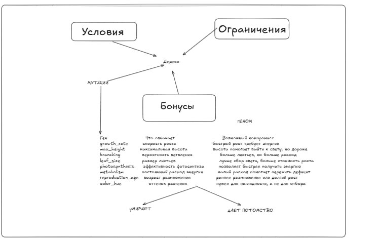
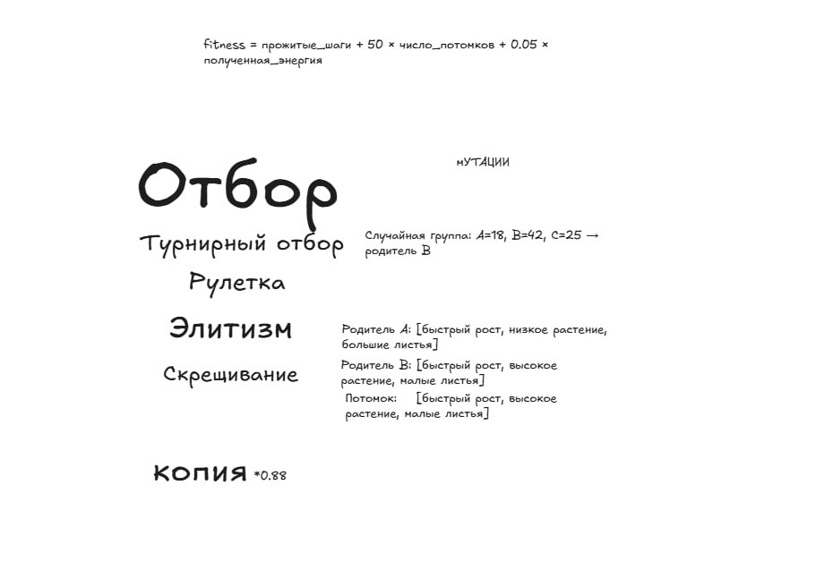

# Evolution Simulator

A visual plant-evolution simulator with heredity, mutations, limited resources, and environmental pressure.

## About the project

Plants live in a two-dimensional world. They collect water and light, gain and spend energy, grow, reproduce, and pass slightly modified genomes to their offspring.

A lake is located on the left side of the world. It continuously supplies nearby soil with water, so environmental conditions differ between the shoreline and the dry side. Plants compete for resources and space, and the population changes across generations.

## Project goal

The goal was to understand heredity, mutation, natural selection, and computational experiments by building a model in which complex behavior emerges from simple rules.

The main questions were:

- How can inherited traits be represented as numbers?
- How can an offspring receive a mutated genome?
- How do limited resources affect survival and reproduction?
- What is the difference between a genome and a grown organism?
- How can a random simulation be reproduced?
- How should computational experiments be designed?
- How should the limitations of a model be reported honestly?

## Implemented features

- a 140×70-cell world;
- soil, water, and light;
- a lake on the left side;
- a soil-moisture gradient from the lake;
- seasonal changes in light and water;
- plants made of stems, branches, and leaves;
- energy gain and energy costs;
- growth and aging;
- reproduction;
- genome inheritance;
- bounded random mutations;
- multiple generations;
- competition for space and resources;
- population statistics;
- a population-history chart;
- inspection of a selected plant's genome;
- a visible soil-moisture layer;
- pause, reset, and speed controls;
- double-click launch without a terminal;
- headless experiments;
- automated model tests.

## The genome

Every plant receives an immutable `Genome` containing inherited traits:

| Trait | Meaning |
|---|---|
| `growth_rate` | growth speed |
| `max_height` | maximum height |
| `branching` | probability of branching |
| `leaf_size` | leaf size |
| `photosynthesis` | energy-production efficiency |
| `metabolism` | constant energy cost |
| `reproduction_age` | age at which reproduction becomes possible |
| `color_hue` | plant color used for visualization |

The genome is a set of inherited parameters. The actual grown form is the phenotype, which depends on the genome as well as water, light, available space, and neighboring plants.

## One simulation step

During every step, the program:

1. Determines the current season.
2. Restores water in the soil.
3. Lets plants collect water and light.
4. Calculates gained energy.
5. Subtracts metabolic costs.
6. Lets eligible plants grow.
7. Checks reproduction conditions.
8. Creates mutated offspring.
9. Removes dead plants.
10. Records population statistics.

The event order is fixed because a different order could change the result.

## How evolution emerges

The simulator does not contain a command that directly selects the “best” plant. Selection emerges from the environment:

- a plant with insufficient water or light gains little energy;
- larger plants require more energy;
- reproduction requires age, energy, and free space;
- a plant that dies before reproduction does not pass on its genome;
- genomes that produce more offspring become more common.

An offspring receives a copy of its parent's genome. Each trait has a small probability of changing by a random amount. The result is then restricted to an allowed range.

## What I learned

This project introduced me to:

- dataclasses and immutable objects;
- class composition;
- discrete simulations;
- two-dimensional coordinates;
- sets and dictionaries;
- energy budgets;
- limited resources;
- heredity and mutation;
- Gaussian random changes;
- value clamping with `min` and `max`;
- reproducibility with `random.Random(seed)`;
- separation of model, data, and interface;
- JSON configuration files;
- Pygame and event handling;
- statistics collection;
- batch experiments;
- CSV export;
- automated tests;
- profiling;
- hypotheses and model limitations.

